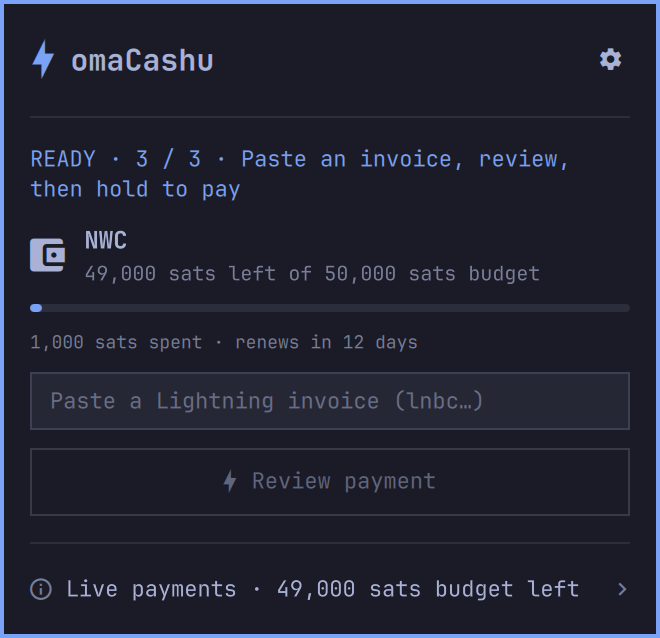

# omaCashu

**A Lightning + Cashu wallet for the Omarchy bar.**
*Your wallet. Every payment confirmed.*



*Actual capture of the installed panel with the warning dismissed, using an NWC Faucet test wallet (fake sats and a simulated budget).*

[](#alpha-warning)
[](#security-model)
[](https://nips.nostr.com/47)
[](LICENSE)

omaCashu pays Lightning invoices from your Omarchy bar using your existing **Lightning or NWC-enabled Cashu wallet** (Nostr Wallet Connect, NIP-47). The wallet connection never enters the desktop shell. A small helper keeps it in your system keyring, supports wallets with or without budget reporting, verifies every invoice, and pays only after you **press and hold** to confirm.

> [!CAUTION]
> ## Alpha warning
> **0.2.0-alpha is experimental and has not been independently audited.** Use a **new, small, budget-limited** wallet connection created just for omaCashu. Anything running as your Omarchy user could spend everything the connection permits. Never paste a seed phrase or private key anywhere in this project.

## How it works

| Step | What happens |
|---|---|
| 1. **Connect** | `omacashu connect` asks for an NWC connection string (hidden input). It checks that the connection can pay invoices; budget reporting is optional and there is no local spending ceiling. Then it saves the connection to your system keyring. |
| 2. **Review** | Paste an invoice into the panel. The helper checks the signature and confirms it's a mainnet invoice with an amount that hasn't expired, hasn't been paid before, and fits any reported remaining budget. The panel shows only the helper's verified details. |
| 3. **Hold to pay** | Press and hold the button, or hold <kbd>Space</kbd>, for 1.5 seconds. The helper pays once and checks the proof of payment (preimage). The helper blocks invoices recorded as paid or unresolved in its local ledger. |

## Requirements

- Omarchy 4 (Quattro)
- For live payments: the **omaCashu helper**, installed with one click from the panel. It needs:
  - Node.js 22+ (`nodejs-lts-jod`)
  - `libsecret` (`secret-tool`) with a Secret Service keyring such as gnome-keyring (Omarchy default)
  - systemd user services
- An NWC wallet whose connection allows `pay_invoice`. Budget reporting (`get_budget`) is optional; limits configured in the wallet still apply.

The helper's npm dependencies are exact-pinned in `helper/package-lock.json`. They are installed with install scripts disabled and come from the npm registry. The plugin itself has no dependencies.

## Install

> [!WARNING]
> Omarchy plugins run as **unsandboxed** code inside `omarchy-shell`. Review `BarWidget.qml`, `Panel.qml` and `helper/` before installing.

```bash
omarchy plugin add https://github.com/yaeloss/omacashu.git --enable
```

Then click the bolt (󱐋) in the bar. The panel guides you through three steps:

1. **Install helper**: the panel opens a terminal running `helper/install.sh`. It installs only into your home directory:
   - `~/.local/share/omacashu/helper`
   - a sandboxed user service called `omacashu-helper`
   - the `~/.local/bin/omacashu` command
2. **Connect wallet**: in your wallet, create a new NWC connection with:
   - **Pay invoices** permission;
   - optionally, a wallet-side **budget**;
   - any other permissions you like (omaCashu only uses paying and reading the budget).

   Choose **Continue in secure prompt**. Paste the connection into the hidden `omacashu connect` prompt, review the budget, and type `yes` to save. Reopen the panel or choose **I’ve finished — check setup** to continue.
3. Paste an invoice, review it, and hold to pay.

You can run each step from a terminal instead:

```bash
~/.config/omarchy/plugins/io.github.yaeloss.omacashu/helper/install.sh
omacashu connect
omacashu status
```

For setup problems and recovery steps, see [the onboarding guide](docs/ONBOARDING.md).

## Update

```bash
omarchy plugin update io.github.yaeloss.omacashu
```

Then choose **Settings (gear) → Update helper** in the panel, or re-run `helper/install.sh`.

## Remove

```bash
~/.config/omarchy/plugins/io.github.yaeloss.omacashu/helper/uninstall.sh   # helper, service, optional keyring entry
omarchy plugin remove io.github.yaeloss.omacashu
```

Also **revoke the connection in your wallet**. Removal leaves nothing behind except, if you choose to keep it, the payment ledger in `~/.local/state/omacashu`.

## Security model

```text
 omarchy-shell (unsandboxed, shared)          omacashu-helper (your user, sandboxed service)
┌──────────────────────────────────┐  unix  ┌─────────────────────────────────────────────┐
│ omaCashu panel (QML)             │ socket │ NWC connection from the system keyring       │
│ • no wallet secret, ever         ├───────▶│ • wallet budget optional                     │
│ • shows helper-verified details  │  0600  │ • BOLT11 signature/network/amount/expiry     │
│ • hold-to-pay confirmation       │        │ • single-use confirmations, paid-hash ledger │
└──────────────────────────────────┘        └──────────────────────┬──────────────────────┘
                                                                   │ NIP-47 (encrypted, via relay)
                                                                   ▼
                                                     Your wallet enforces the budget
```

- **Wallet-side restrictions define your exposure.** The helper keeps the secret out of the shell, but malware running as your user could still read the keyring entry or talk to the helper socket. Keep the budget small and revoke the connection if in doubt.
- **The panel's only capabilities** are:
  - one socket to the helper;
  - one fixed command that opens a terminal for `install`, `connect` or `disconnect`.

  It has no process, file, network, clipboard or URL access. CI enforces this in `tests/test_plugin.py`.
- **Higher assurance:** [`trusted/`](trusted/) contains an optional kit for keeping the wallet on a separate device. The desktop can propose invoices to it but never approve them.

Details: [SECURITY.md](SECURITY.md) · [Threat model](docs/THREAT_MODEL.md) · [Live wallet design](docs/LIVE_WALLET_DESIGN.md)

## Repository layout

```text
manifest.json  BarWidget.qml  Panel.qml   Omarchy plugin (loaded by omarchy-shell)
helper/                                   desktop wallet helper (Node, installed separately)
trusted/                                  optional separate-device kit (broker, SSH bridge, CLI)
docs/  tests/  assets/  .github/
```

## Development

```bash
python3 -m unittest discover -s tests -v                 # plugin rules
(cd helper && npm ci && npm test)                        # helper: BOLT11 spec vectors, policy, service, socket
node helper/test/e2e/faucet-e2e.mjs                      # optional: real payment between NWC Faucet test wallets
(cd trusted && python3 -m unittest discover -s tests -v) # optional kit
omarchy plugin validate .
```

See [CONTRIBUTING.md](CONTRIBUTING.md) for `qmllint` and on-device testing.

## References

[NIP-47](https://nips.nostr.com/47) · [BOLT #11](https://github.com/lightning/bolts/blob/master/11-payment-encoding.md) · [Alby JS SDK](https://github.com/getAlby/js-sdk) · [Omarchy plugin reference](https://github.com/omacom/omarchy/blob/quattro/shell/plugins/README.md)

## Disclaimer

Experimental open-source software provided as-is, without warranty. You are responsible for the budget you grant. omaCashu is an independent community project, not affiliated with Omarchy, Alby, Cashu or Nostr. Nothing here is financial advice.

License: [MIT](LICENSE).
